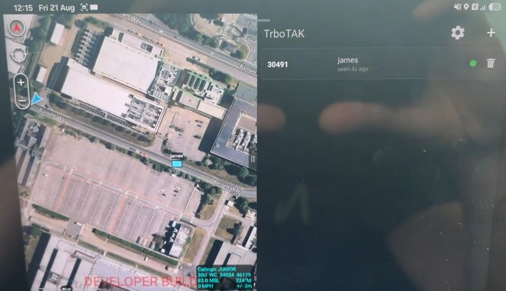

# TrboTAK Plugin

TrboTAK is an ATAK plugin that puts Motorola DMR radios on ATAK.

It polls each enrolled radio for its GPS position using the Location Request and
Response Protocol ([LRRP](LRRP.md)), shows each radio as a unit marker, and can
send positions to other TAK clients as Cursor on Target (CoT).



https://www.youtube.com/watch?v=q7mU4CFjcWo

## Requirements

- **ATAK** (Android Team Awareness Kit), CIV 5.6.0. The plugin is built against that
  plugin API, so it must match the ATAK version installed on the device.
- **A Motorola MOTOTRBO DMR radio that supports LRRP**, with:
  - GNSS/GPS enabled and a working GPS fix
  - location services (LRRP) enabled in the radio's codeplug
  - a data link to the Android device: Bluetooth PAN, USB tethering, or a Wi-Fi
    network that both the radio and the device are on
- An Android device that can run ATAK and has Bluetooth, USB tethering or Wi-Fi,
  depending on how the radio connects.

## Installation

1. Install ATAK on the device.
2. Install the TrboTAK plugin APK (`ATAK-Plugin-<project>-<version>-...-5.6.0-civ-release.apk`).
3. Open ATAK and go to **Settings → Tool Preferences → Plugins** (or the Plugins
   screen in the overflow menu) and load TrboTAK if it is not loaded already.
4. TrboTAK now shows up in the ATAK toolbar or overflow menu.

## Operating the plugin

### 1. Connect the radio to the device

- **Bluetooth (default):** pair the radio with the device in Android Bluetooth
  settings and turn on network access (Bluetooth PAN / tethering) for the radio.
- **USB:** connect the radio with a data cable and turn on USB networking.
- **Wi-Fi:** connect the radio and the device to the same Wi-Fi network.

### 2. Configure settings

Open TrboTAK and tap the **cog** icon to open **TrboTAK Settings**:

| Setting | Description |
|---|---|
| **NIC** | The link the radio is on: `Bluetooth` (default), `Wi-Fi` or `USB`. The plugin binds its sockets to this link, so traffic doesn't go out over another network such as cellular. |
| **Refresh** | How often the radio reports its position, 5–20 seconds (default 10). |
| **CoT Broadcast address** | Where position reports are sent for other TAK clients. Tap **?** for help. The line under the field shows what the address you typed means on the selected link. |

CoT address options:

| Value | Result |
|---|---|
| *(blank)* | This device only. Nothing is sent to the network. |
| `255.255.255.255` *(default)* | Broadcast to every ATAK on the selected link's subnet, port 4242. |
| `239.2.3.1:6969` | ATAK's mesh SA multicast group. |
| `192.168.1.50:4242` | Unicast to one device or TAK server. |

If you don't give a port, the plugin uses **4242**. The receiving ATAK needs a UDP
input on whatever port you choose.

Tap **Save**. An invalid address keeps the dialog open so you can fix it.

### 3. Add radios

Tap **+** and enter:

- **ID**: one of these:
  - the radio's **DMR radio ID**, e.g. `30491`. The plugin turns this into the radio's
    MOTOTRBO address in `12.0.0.0/8` (30491 → `12.0.119.27`). This only works over a
    tethered link (Bluetooth or USB).
  - the radio's **IPv4 address**, e.g. the Bluetooth PAN gateway address or the
    radio's Wi-Fi IP. **On Wi-Fi you must use the IP address.**
- **Name**: the callsign shown on the map marker.

Once a radio is added, the plugin subscribes it to send a position report at the
Refresh interval. The radio list is saved and comes back when ATAK restarts.

### 4. Read the radio list

Each row shows the radio's ID, name and a status dot:

| Dot | Meaning |
|---|---|
| 🟢 Green | Position received in the last 20 seconds |
| 🟠 Amber | Last position 20–60 seconds old |
| 🔴 Red | No position for more than 60 seconds, or never |

The detail line shows `seen Ns ago`, or, if the radio has never sent a position,
`no reply` or the status the radio reported (see [Troubleshooting](#troubleshooting)).

- **Tap a row** to pan the map to that radio.
- **Tap the trash icon** to stop polling the radio and remove it and its marker.
- **Simulate** sends a made-up LRRP position for the first radio in the list, at a
  point near the map centre with an altitude of 123.5 m. It goes through the same
  socket and decoder as a real reply, so you can test the plugin and CoT output
  without a radio.

Markers are CoT type `a-f-G-U` (friendly ground unit) with the radio ID as the UID.
They go stale after 60 seconds without an update.

When the plugin is unloaded it sends each radio a stop request so the radio stops
sending position reports.

## Network ports and protocols

| Purpose | Protocol | Port | Direction | Notes |
|---|---|---|---|---|
| LRRP location requests and replies | UDP | **4001** | Device ↔ Radio | The plugin binds local port 4001 and sends to the radio on port 4001. Uses triggered (periodic) location requests that ask for altitude. |
| CoT to other TAK clients | UDP | **4242** (default) | Device → Network | CoT XML (event version 2.0). Can be broadcast, multicast or unicast. |
| ATAK mesh SA (optional) | UDP multicast | **6969** | Device → Network | Group `239.2.3.1`. Multicast TTL is 1 (local link only). |

Addressing:

- **Radio ID addressing:** radio ID + `12.0.0.0` → `12.x.x.x`. The radio or its PAN
  gateway routes this on the tethered link.
- **Direct IP addressing:** any IPv4 address you type in the ID field.
- **Link binding:** sockets are bound to the link chosen under NIC. Bluetooth looks for
  interfaces named like `bt-*`, `bnep*` or `*pan*`, and USB for `rndis*`, `usb*` or
  `eth*`. If the link drops and reconnects, the plugin binds to it again within about
  5 seconds.
- **Re-subscription:** if a radio hasn't replied for 3× the Refresh interval, the plugin
  sends the location request again.

Android permissions used: `INTERNET` (UDP) and `ACCESS_NETWORK_STATE` (to find the
radio's link).

For how LRRP works, with example packets broken down byte by byte, see
[LRRP.md](LRRP.md).

## Troubleshooting

### All radios stay red / "no reply"

1. **Make sure Bluetooth is enabled.** Check that Bluetooth is on, that the radio is
   paired and connected, and that **network access / PAN** is turned on for the radio
   in Android Bluetooth settings. Turn the radio off and on, or reconnect, if needed.
2. **Check the NIC setting.** It must match how the radio is connected
   (Bluetooth / USB / Wi-Fi).
3. **Make sure the radio supports LRRP.** Not every MOTOTRBO model or firmware
   supports LRRP, and GPS and location services have to be enabled in the codeplug.
   If you aren't sure, check the model and codeplug with your radio administrator.
4. **Ping the radio's IP.** With a terminal app on the device (e.g. Termux) or a
   network tools app, ping the address the plugin is using:
   ```sh
   ping 12.0.119.27          # radio ID 30491, or
   ping 192.168.10.1         # the PAN gateway / Wi-Fi IP you typed in
   ```
   To force the ping out over the radio link, give the interface:
   ```sh
   ping -I bt-pan 12.0.119.27
   ```
   If the ping fails, the problem is the link or routing, not the plugin. Reconnect the
   radio, check the IP address, or add the radio by its gateway IP instead of its ID.
5. **Wi-Fi with radio IDs:** IDs (`12.x.x.x`) only work over Bluetooth or USB. On Wi-Fi,
   remove the radio and add it again using its Wi-Fi IP. The plugin shows a warning
   when this applies.

### Radio replies but there's no position

The row's detail line shows what the radio reported:

| Status | Meaning | Action |
|---|---|---|
| `no-gps` | The radio is reachable but has no GPS fix | Move it to open sky and wait for a fix |
| `not-enough-gps` | Not enough satellites yet | Wait, or improve sky view |
| `bad-command` | The radio rejected the request | Check the radio supports LRRP and location is enabled |
| `ack` | The radio accepted the request; the position hasn't arrived yet | Wait one Refresh interval |

### "Unable to listen on port 4001"

Another app on the device is already using UDP port 4001 (for example another LRRP or
MOTOTRBO app). Close it and reload the plugin.

### Markers show locally but not on other ATAK devices

- Check the **CoT Broadcast address**. Blank means local only.
- Read the line under the address field. If it says the address is *not on this link*,
  the packets won't arrive. Use an address on the selected link's subnet.
- Check the receiving ATAK has a UDP input on the port in use (4242 by default, or
  6969 for `239.2.3.1`).
- Broadcast and multicast don't cross routers. Use unicast to a TAK server to reach
  other networks.

### Testing without a radio

Add any radio (e.g. ID `1`, name `Test`) and tap **Simulate**. If a marker appears
next to the map centre, the plugin, decoder and CoT path are working, so look for the
problem in the radio or the link.

### Logs

Filter `adb logcat` for these tags: `LrrpPoller`, `UdpTransport`, `RadioLink`,
`CotSender`, `TrboTakDropDownReceiver`.

---

## Credits

We owe this work to the enthusiasts who shared knowledge to help people communicate:

Rocky Mountain Ham Radio videos were useful:

https://www.rmham.org/

Andy Kirby's MotoTrbo "LONG RANGE DATA COMMS SOLUTION" video is recommended viewing:

https://www.youtube.com/watch?v=d6ojhpRzyVI

Wayne Holmes / DJ0WH blogged about LRRP in 2023:

https://cwh050.blogspot.com/2023/01/the-settings-needed-to-get-location.html

Our intern James who developed this.

Claude for taking the pain out of making tak plugins.

The UK radio dealer who said it wasn't possible without a repeater...


---


TrboTAK by [CloudRF.com](https://cloudrf.com)
